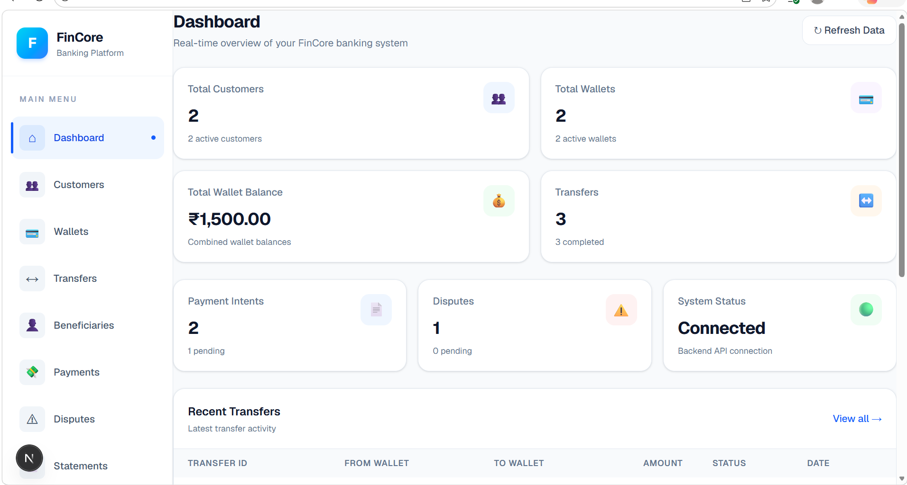
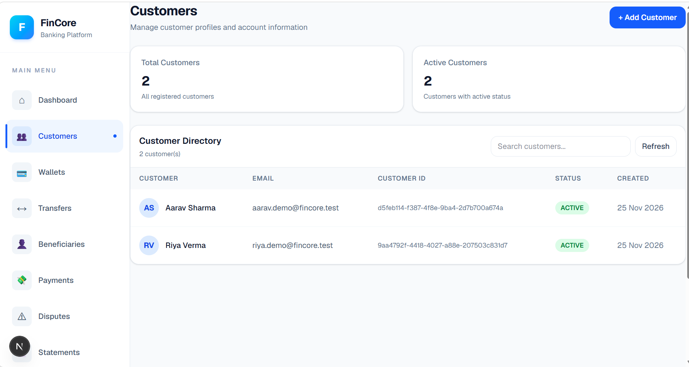
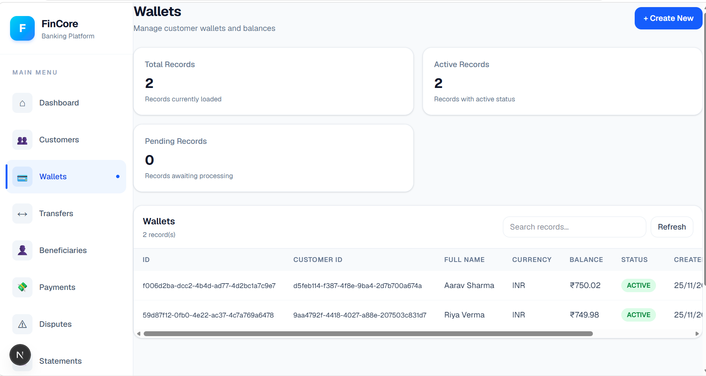
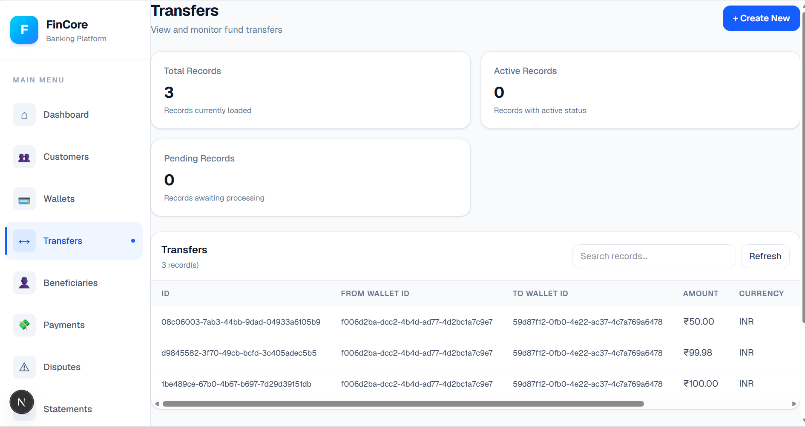
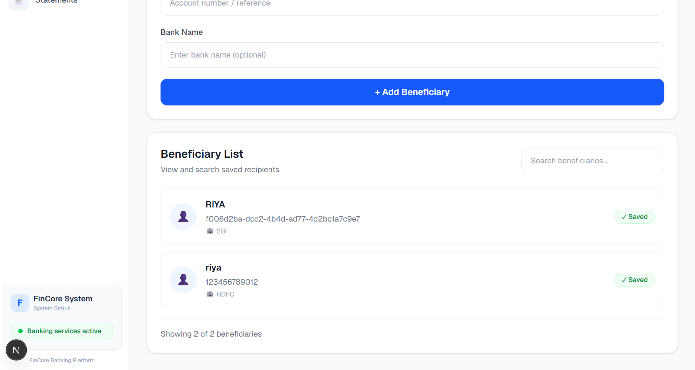
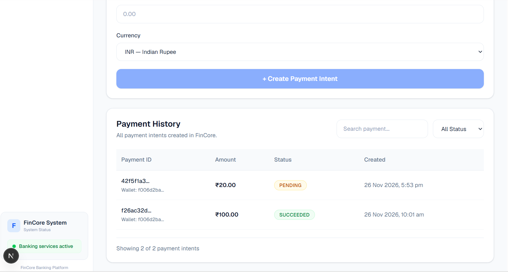
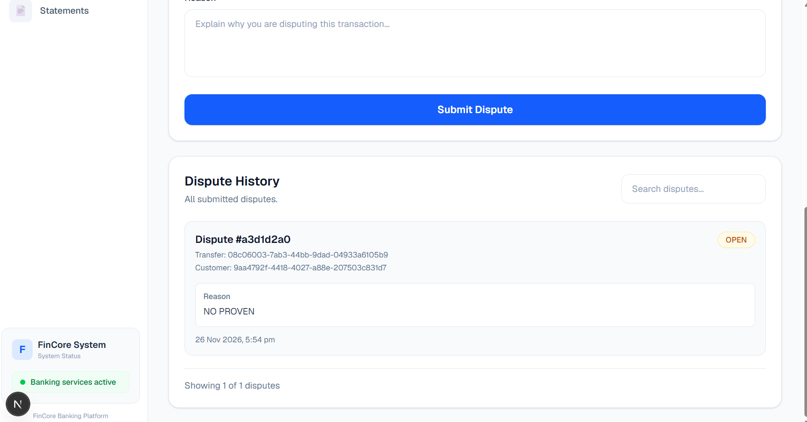
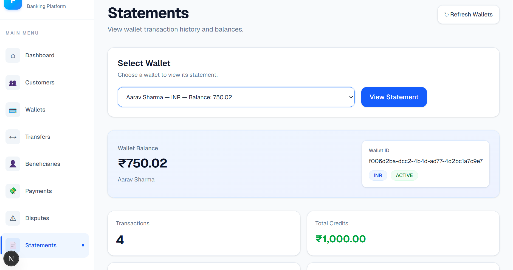
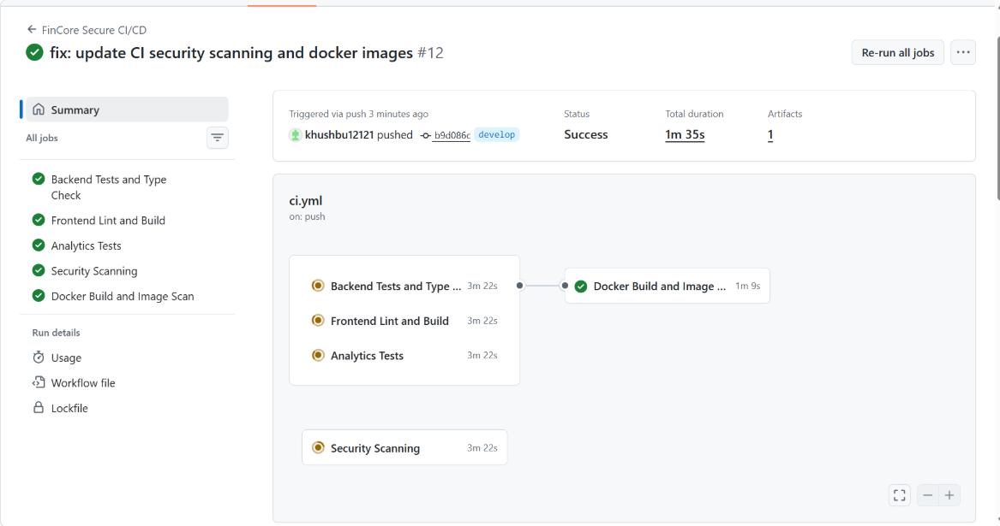

# FinCore

FinCore is a financial services application designed to manage customer accounts, wallets, financial transactions, payments, beneficiaries, disputes, and account statements.

The project demonstrates a modular financial platform with a web interface, backend API, database infrastructure, and supporting analytics services.

## Features

- Dashboard for monitoring financial activity
- Customer management
- Wallet management
- Wallet-to-wallet transfers
- Beneficiary management
- Payment processing and payment history
- Dispute management
- Account statements and transaction ledgers
- Transaction history and balance tracking
- Backend API integration
- Database-backed services
- Docker-based infrastructure

## Tech Stack

### Frontend
- Next.js
- React
- TypeScript
- Tailwind CSS

### Backend
- API service
- TypeScript / Node.js
- PostgreSQL

### Infrastructure & Services
- Docker
- Docker Compose
- PostgreSQL 17
- Redis 7
- Analytics service
- GitHub

## Project Structure

```text
FinCore/
├── apps/
│   ├── api/              # Backend API service
│   └── web/              # Next.js frontend application
├── assessments/           # Assessment-related files
├── backups/               # Backup files
├── database/              # Database-related files
├── docs/                  # Project documentation
├── infra/                 # Infrastructure configuration
├── services/
│   └── analytics/         # Analytics service
├── src/
│   └── components/        # Shared components
├── tests/                 # Test files
├── docker-compose.yml
├── concurrency-test.js
├── .env.example
└── README.md

## Screenshots

### Dashboard


### Customers


### Wallets


### Transfers


### Beneficiaries


### Payments


### Disputes


### Statements


### CI/CD Pipeline
